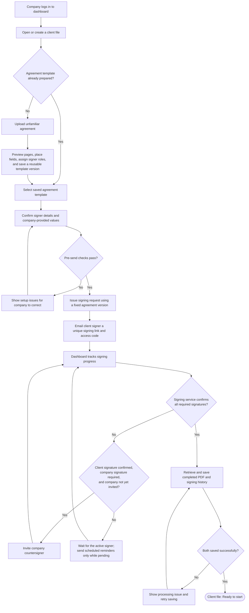
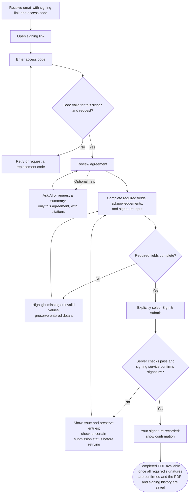

# Astra_Round2

Planned agreement workflows for company staff and client signers.

## Company workflow

## Client workflow

Code verification grants access; it does not sign the agreement. AI assistance is optional, and signing remains available if the assistant is unavailable.
