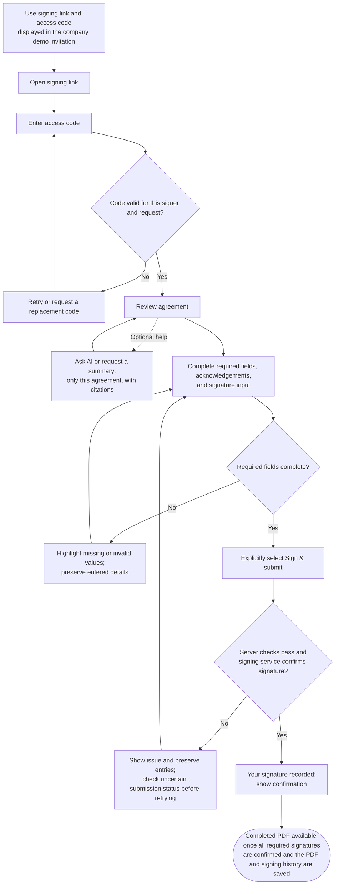

# Astra_Round2

Planned agreement workflows for company staff and client signers.

## Local UI

Run `python backend/manage.py runserver` in the existing virtual environment, then open `http://127.0.0.1:8000/company/login/`. Company sign-in opens the protected dashboard.

All interface code is in `frontend/`. Login and dashboard each have one HTML, CSS, and JavaScript file. Shared templates, theme, controls, session helpers, and assets are in `frontend/shared/`.

Company staff can create, save, reopen, and update client-file drafts. Drafts are stored in the database and scoped to the signed-in company account. The dashboard includes company-wide counts, search, status filters, sorting, and paginated file lists. Saving a draft does not create a signing request or invitation.

Run `python -m pip install -r backend/requirements.txt` in the existing virtual environment, then `python backend/manage.py migrate` after pulling database changes. Local development uses the SQLite database in `backend/.local/`; deployment requires persistent database storage. No frontend dependencies are required.

## Agreement upload and preview

Open **Agreement templates** to upload a PDF or DOCX, review its pages, and reopen saved agreements. Originals and preview PDFs are limited to **10 MiB and 50 PDF pages**. Every uploaded agreement remains **Unprepared**; document validation does not publish a template or change a client file's status.

The server checks the actual PDF and renders every page before saving. Empty, corrupt, encrypted/password-protected, unsupported, oversized, and overlong documents are rejected with an inline explanation. Preview pages load individually, with page navigation and zoom. They are rendered images, so preview text cannot be selected or searched; scanned PDFs do not require OCR for this feature.

Original PDFs are stored unchanged through the existing private storage layer. Each saved agreement and preview request requires company authentication and ownership. Documents are not served through static/media URLs. Refreshing or signing in again preserves the saved agreement list; a selected agreement has a workspace link that can be reopened.

`pypdfium2` (with its bundled PDFium engine) and Pillow perform local rendering without an external service or API charge. This uses server CPU and memory and requires a supported native PDFium wheel. Processing runs in a separate process with a 30-second timeout, a 512 MiB memory cap, and a maximum 1800-pixel preview edge. Limits are centralized in `backend/settings.py`. Large or complex PDFs may need to be re-exported to fit processing limits. A deployed host needs persistent private disk storage at `DJANGO_AGREEMENT_STORAGE_ROOT` as well as its database; the local default is `backend/.local/agreements/`. Keep this directory outside public/static/media folders and out of Git. Free-tier storage and compute quotas still apply.

## DOCX conversion setup

DOCX conversion requires a running Linux Docker engine accessible to the Django service account. Build the dedicated image before starting Django:

```powershell
docker build -t astra-docx:local backend/agreements/converter
```

The image contains LibreOffice Writer and Liberation/DejaVu fonts. It uses no paid conversion service and adds no Python or frontend package. Conversion runs as an unprivileged user with networking disabled, no host mounts, a read-only root, a 192 MiB temporary filesystem, 512 MiB memory/no swap, one CPU, 64 processes, and a 48-second worker lifetime (55-second caller timeout). Containers and temporary files are removed after processing. DOCX inspection limits ZIP entries, expansion, and XML; macros, active/embedded objects, external relationships (including hyperlinks), and external-content fields are rejected with guidance to export a PDF. Originals stay byte-for-byte unchanged; converted PDFs are separate private artifacts with engine/version, hashes, sizes, and page geometry recorded. Converted PDFs pass the same full-page validation as PDF uploads. Review every converted page: font substitution and Word layout differences can change pagination.

Deployment must support launching isolated Linux containers and persistent private storage within its free quotas. Many free app hosts do not expose a container runtime; those hosts cannot run this converter as configured. No free hosting provider is assumed or selected. Docker access is a trusted administrator capability: do not expose the daemon/socket to users. Configure `DJANGO_AGREEMENT_DOCKER_COMMAND` and `DJANGO_AGREEMENT_DOCX_IMAGE` if needed; deploy an administrator-built image pinned by digest, rebuild for security updates, and retain the image used for each deployment. No image pulls occur during uploads. If conversion is unavailable, users can retry the same upload or upload a PDF. Existing PDF processing does not require Docker.

## Field-preparation drafts

Open a validated agreement and select **Prepare fields**. Add name, text, date, signature, initials, or acknowledgement placeholders. Select a placeholder on the page or through the field selector, then edit its label, client/company role, and required flag. Move/resize by dragging or by using the numeric position and size controls. Delete the selected field through its button (or Delete/Backspace while the placeholder has keyboard focus).

Positions use fractions of the displayed PDF page, measured from the top-left corner: x/y locate the top-left edge; width/height describe the field size. Zoom and window resizing use the same fractions. Each saved field belongs to the immutable agreement PDF hash and page. The server checks supported types/roles, finite coordinates, page numbers, and full field boundaries. Drafts allow blank labels, missing signer roles/signature fields, or no fields at all; saving does not require completed preparation. A draft supports up to 200 fields and a 256 KiB request body.

**Save field draft** persists the draft for reopening. The interface shows pending changes, saving, errors, and confirmation, and warns before leaving unsaved changes. Edits made during a save remain unsaved until saved separately. Concurrent saves use a draft revision; a stale tab cannot silently replace another tab's changes. A lost response can be retried with the same field content. Apply database migrations before starting the app after updating.

Signature and initials boxes are placeholders only. Saving keeps the agreement **Unprepared** and creates no reusable template, recipients, invitation, or signatures. Publishing/versioning and signing remain later work.

## Company workflow


## Client workflow



Code verification grants access; it does not sign the agreement. AI assistance is optional, and signing remains available if the assistant is unavailable.
