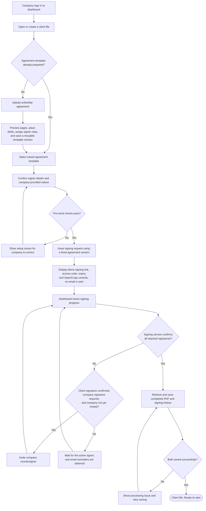
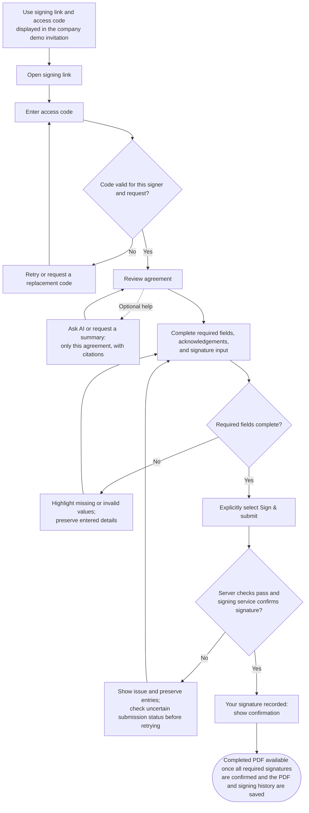

# Astra_Round2

Agreement preparation and signing for company staff and client signers.

## Deployment preparation

The Ubuntu deployment configuration and source-only release packager are in
[`deploy/`](deploy/README.md). Install `backend/requirements-production.txt` for
production dependencies; Windows skips the Linux-only Gunicorn server. Local
development keeps its existing SQLite configuration. These files describe how to
reproduce an installation; live deployment state is maintained separately.
No private documents, local credentials or planning instructions belong
in a release package.

## Local UI

From the project root, use Python 3.12 and PowerShell:

```powershell
python -m venv .venv                       # Fresh checkout only
.venv/Scripts/python.exe -m pip install -r backend/requirements.txt
.venv/Scripts/python.exe backend/manage.py migrate
.venv/Scripts/python.exe backend/manage.py runserver
```

Open `http://127.0.0.1:8000/company/login/`. Keep the server window open; Ctrl+C stops it. A fresh checkout contains no accounts or uploaded documents. In a separate terminal, create a local company with `.venv/Scripts/python.exe backend/provision.py company --email company@example.test --name "Demo Company"`; enter its password at the prompts. Existing checkouts retain their accounts and data and do not need provisioning again.

All interface code is in `frontend/`. Login and dashboard each have one HTML, CSS, and JavaScript file. Shared templates, theme, controls, session helpers, and assets are in `frontend/shared/`.

The company workspace groups **clients → jobs/files → agreements**. Save a client’s contact and default signer details once, expand that client, and create a job with one or more published template versions. Staff can add more agreements to an existing job later. Each agreement keeps its own draft, recipients, signing request, status, completed PDF and history; creating these drafts does not issue them. Review and issue each agreement explicitly. A job is ready to start only when all its agreements are completed.

From a job, choose **Upload a new agreement** and select **For this job only** or **Also make it a reusable template** before uploading. Both paths require document validation, field preparation and a ready immutable version. Job-only uploads stay out of the shared template library and cannot be assigned to another job. Selecting reusable makes its published versions available for other client jobs too. Demo invitation links and access codes remain separate for each agreement. After verification, the client portal lists issued agreements across jobs for the same client record and verified signer email. No email is delivered.

The grouping migration preserves existing signing records, values and artifacts. Existing agreement records become individual jobs; records with the same company, client name and nonempty contact email share a client. Records without a contact email are kept separate to avoid merging people by name alone. The internal `ClientFile` model and existing signing routes remain compatible and represent individual agreement workflows under the new `ClientJob` grouping.

Run `python -m pip install -r backend/requirements.txt` in the existing virtual environment, then `python backend/manage.py migrate` after pulling database changes. Local development uses the SQLite database in `backend/.local/`; deployment requires persistent database storage. No frontend dependencies are required.

## Agreement upload and preview

Open **Agreement templates** to upload a PDF or DOCX, review its pages, and reopen saved agreements. Originals and preview PDFs are limited to **10 MiB and 50 PDF pages**. Uploads start with **Needs preparation**. Finish preparation to create a ready version; document validation alone does not publish it.

The server checks the actual PDF and renders every page before saving. Empty, corrupt, encrypted/password-protected, unsupported, oversized, and overlong documents are rejected with an inline explanation. Preview pages appear in continuous reading order, with page navigation and zoom. They are rendered images, so preview text cannot be selected or searched; scanned PDFs do not require OCR for this feature.

Original PDFs are stored unchanged through the existing private storage layer. Each saved agreement and preview request requires company authentication and ownership. Documents are not served through static/media URLs. Refreshing or signing in again preserves the saved agreement list; a selected agreement has a workspace link that can be reopened.

`pypdfium2` (with its bundled PDFium engine) and Pillow perform local rendering without an external service or API charge. This uses server CPU and memory and requires a supported native PDFium wheel. Processing runs in a separate process with a 30-second timeout, a 512 MiB memory cap, and a maximum 1800-pixel preview edge. Limits are centralized in `backend/settings.py`. Large or complex PDFs may need to be re-exported to fit processing limits. A deployed host needs persistent private disk storage at `DJANGO_AGREEMENT_STORAGE_ROOT` as well as its database; the local default is `backend/.local/agreements/`. Keep this directory outside public/static/media folders and out of Git. Free-tier storage and compute quotas still apply.

## DOCX conversion setup

DOCX conversion requires a running Linux Docker engine accessible to the Django service account. Build the dedicated image before starting Django:

```powershell
docker build -t astra-docx:local backend/agreements/converter
```

The image contains LibreOffice Writer and Liberation/DejaVu fonts. It uses no paid conversion service and adds no Python or frontend package. Conversion runs as an unprivileged user with networking disabled, no host mounts, a read-only root, a 192 MiB temporary filesystem, 512 MiB memory/no swap, one CPU, 64 processes, and a 48-second worker lifetime (55-second caller timeout). Containers and temporary files are removed after processing. DOCX inspection limits ZIP entries, expansion, and XML; macros, active/embedded objects, external relationships (including hyperlinks), and external-content fields are rejected with guidance to export a PDF. Originals stay byte-for-byte unchanged; converted PDFs are separate private artifacts with engine/version, hashes, sizes, and page geometry recorded. Converted PDFs pass the same full-page validation as PDF uploads. Review every converted page: font substitution and Word layout differences can change pagination.

Deployment must support launching isolated Linux containers and persistent private storage within its free quotas. Many free app hosts do not expose a container runtime; those hosts cannot run this converter as configured. No free hosting provider is assumed or selected. Docker access is a trusted administrator capability: do not expose the daemon/socket to users. Configure `DJANGO_AGREEMENT_DOCKER_COMMAND` and `DJANGO_AGREEMENT_DOCX_IMAGE` if needed; deploy an administrator-built image pinned by digest, rebuild for security updates, and retain the image used for each deployment. No image pulls occur during uploads. If conversion is unavailable, users can retry the same upload or upload a PDF. Existing PDF processing does not require Docker.

## Field-preparation drafts

Open a validated agreement and select **Prepare fields**. Add name, text, date, signature, initials, or acknowledgement placeholders. Select a placeholder on the page or through the field selector, then edit its label, completion assignment, and required flag. Assign fields to the client signer, company countersigner, or company preparation before sending. Preparation supports text, name and date fields only; signatures, initials and acknowledgements remain signer inputs. Move/resize by dragging or by using the numeric position and size controls. Delete the selected field through its button (or Delete/Backspace while the placeholder has keyboard focus).

Positions use fractions of the displayed PDF page, measured from the top-left corner: x/y locate the top-left edge; width/height describe the field size. Zoom and window resizing use the same fractions. Each saved field belongs to the immutable agreement PDF hash and page. The server checks supported types/roles, finite coordinates, page numbers, and full field boundaries. Drafts allow blank labels, missing signer roles/signature fields, or no fields at all; saving does not require completed preparation. A draft supports up to 200 fields and a 256 KiB request body.

**Save field draft** persists the draft for reopening. The interface shows pending changes, saving, errors, and confirmation, and warns before leaving unsaved changes. Edits made during a save remain unsaved until saved separately. Concurrent saves use a draft revision; a stale tab cannot silently replace another tab's changes. A lost response can be retried with the same field content. Apply database migrations before starting the app after updating.

Signature and initials boxes are placeholders only. Saving keeps the preparation draft **Unprepared** and does not publish a version. It creates no invitation or signatures.

## Published template versions

In **Prepare fields**, enter a template name and save the preparation draft, then select **Finish preparation**. Publication requires a validated PDF, valid fields on that exact PDF, and at least one required client signature field. Any company-role fields also require at least one required company signature field. Publication errors preserve the draft; blank names and incomplete field setup can still be saved as drafts.

Publishing atomically freezes the saved field configuration, roles, template name, and PDF identity. The version references the existing protected Agreement and private PDF artifact; it does not copy document files. Original document metadata, PDF metadata, conversion engine/version, and page geometry remain on that immutable Agreement. The PDF's stored bytes are checked against its validated hash and size before a new version is published. Each saved draft revision can create only one published version; retrying that publication returns the same version. Later changes go through the preparation draft, and publishing a changed saved revision creates the next version without modifying earlier snapshots. Published rows reject application-level updates/deletion, and versions protect their source Agreement from deletion.

Open a published version from the preparation screen's version history to review its PDF and frozen field placeholders through the existing authenticated page preview. Published previews have no field editing controls.

## Select a version for a client file

The existing client-file screen lists the signed-in company's published versions, with **Load more versions** for longer lists. Select an exact name/version, confirm the client signer's name/email, and add company countersigner details when that version includes the company role. **Use client name and email** copies the existing client details only when selected by staff. Missing template or signer setup is listed inline and can be saved unfinished; supplied email addresses must still have a valid format.

Saving retains the exact selected version and signer details when the file is reopened. New publications never advance that selection automatically. **Preview selected version** opens the authenticated, read-only template preview in a new tab. Selection and saving create no signing request, invitation, access code or signature. No new dependency or service is required.

### Company-prepared agreement details

Preparation fields appear on each client file for staff to enter business values such as a fee or job reference (Text), a name, or a date. Values belong to that file; reusable templates contain definitions, not client-specific values. Dates use YYYY-MM-DD. Incomplete drafts can be saved, but populated dates and names must be valid. Changing the selected version clears preparation inputs. Draft saves are limited to 256 KiB.

**Send request — Demo** validates required preparation values and checks that they render legibly before issuing. It rejects stale saved setups and atomically copies preparation values into the immutable request. Repeated sends recover that same request. Preparation fields do not require a company countersigner and cannot supply signatures, initials, acknowledgements or consent.

Authorized client and company review pages show the frozen preparation values on the document pages and in a read-only text list. Template previews continue to show placeholders. The original PDF and its hash remain unchanged; review pages are rendered transiently through the same PDF renderer used for finalization. Finalization combines the request's frozen preparation values with accepted signer submissions, saves the completed PDF privately, and includes preparation values in signing history. Existing templates and requests receive empty preparation-value objects; they are not retroactively filled.

## Optional document assistant

Company preparation and signer review show document pages in a continuous scrolling view, with page numbers and direct page jumps. Nearby previews load as needed. Opening **Prepare fields** brings the right-side AI field helper into view. Each suggestion offers **Go to page N** and **Add field**. Added suggestions move below unadded ones and offer **Remove**, with explicit confirmation before the field is removed from the draft. Both additions and removals require an explicit field-draft save; publication remains separate.

Signers can tap a numbered document box or choose one field at a time. The first signature tap asks them to confirm their typed name; later taps apply that signature only to the selected box within the same review session. **Fill my name and email** fills only empty, clearly labelled name/email fields using that request's assigned recipient details. It preserves existing entries and leaves dates, signatures, initials, acknowledgements and consent for the signer. A required-field count shows progress; the server remains the final validator. **Sign & submit** still requires explicit consent. Field entry is separate from AI assistance. Wide screens show fields on the left, the agreement in the centre, and help on the right. Narrow screens place collapsible help above the document. **Next required field** cycles through unfinished required fields, skips filled fields, and reveals the selected box. On mobile the document toolbar provides the same navigation, and tapping a field opens its editor without discarding other entries.

Open the root `.env` file and set `GROQ_API_KEY=your_free_plan_key_here`, then save and restart Django. This local file is ignored by Git. If it is missing after cloning, create it beside `README.md` with that line. Do not put a key in the browser, source code, screenshots, or chat. Quotes around the value are optional. Only `GROQ_API_KEY` is loaded from this file; other Django settings continue to use server environment variables. A shell `GROQ_API_KEY` takes precedence, including an explicitly empty value. No dotenv package is required.

Use a Groq **Free Plan** organization with `openai/gpt-oss-20b` enabled. No paid fallback, alternate model, web search, or action tools are configured. The API key is server-only. Relevant document text, the question, and frozen company-prepared values are sent to Groq for inference; check its account data controls, including zero data retention. See [Groq model documentation](https://console.groq.com/docs/model/openai/gpt-oss-20b), [free quotas](https://console.groq.com/docs/rate-limits), and [data controls](https://console.groq.com/docs/your-data). Account quotas can differ and change; do not enable paid overages.

The client review page offers **Summarize this agreement** and questions with supporting passages and **Open page** controls. Every request is scoped to the verified client signer, company, signing request, and issued version. Sources use a hash-checked private PDF snapshot plus issued preparation values, excluding later editable drafts. AI is disabled after the client's signature is recorded, including after completed-document re-verification. Document review, signing, and completion access remain independent.

Text extraction runs in the existing bounded PDF process. Every page is accounted for. No OCR is installed: scanned pages, images, PDF forms, and decoding problems cause explicit readability limits. Complete summaries are disabled if any page has a readability limitation. Extraction cannot guarantee correct reading order in complex tables or columns. Citations are validated against supplied authorized passages, but models can still misinterpret wording; clients should check the original pages.

Local defaults: 2,000 characters per question; 14,000 UTF-8 bytes across serialized input messages; 1,000 completion tokens including reasoning; a 30-second provider-process deadline; at most six provider calls per minute and 60 per UTC day shared across the application database. A shared 7,200-token minute budget includes estimated input/schema/output reservations, and only one call runs at a time. Client answers and field suggestions share these budgets. Attempts count even when a provider call fails; no automatic retries occur. Provider quotas may reject requests earlier. Quota, timeout, unconfigured-provider, and invalid-answer errors remain visible without blocking signing.

Complete summaries currently support only agreements whose full readable context fits the input allowance. Larger agreements show an explicit limit; narrower questions use a local passage subset and cannot establish that information is absent elsewhere. Multi-call long-document summaries and OCR are not implemented. No pages are silently truncated into a claimed complete summary. Responses are plain text with application-built citations; document/model content cannot supply executable HTML or action links.

The assistant quota table is added by migration `0009_assistant_budget`; the migration command above applies it. Backend tests use isolated test databases, fictional PDFs, temporary document storage and mocked provider responses. From the root, run `.venv/Scripts/python.exe backend/manage.py test agreements client_files test_local_config` (unqualified discovery from the root finds zero tests), and `node --test frontend/*.test.cjs` with Node.js installed. SQLite's default in-memory test database skips five writer-concurrency tests; use a separate file test database through Django's `DATABASES["default"]["TEST"]["NAME"]` setting to exercise them. Never point test storage or a test database at demo data. A configured API key and a separate live check are still needed to verify model availability and answer quality.

## Company workflow



## Client workflow



Code verification grants access; it does not sign the agreement. AI assistance is optional, and signing remains available if the assistant is unavailable.

## Agreement workspace actions

In the unified Clients page, **By client** expands into jobs with an agreement table showing the signer, preparation/signing status, and next actions. Ready drafts can be sent after confirmation. Pending requests expose **Share link & code**, **Open client view**, and a confirmed **Cancel request** action for that agreement only. Demo delivery sends no email. Visible job statuses refresh periodically and on returning to the window.

Finishing a shared template returns to the library with a completion banner; finishing a job upload opens review and sending. Save and finish controls remain visible while reviewing suggestions. Clear placeholders and company/client signing blocks are classified locally; ambiguous anchors can use Groq. Inline preparation values are fitted within their original text rows in derived PDFs, preserving surrounding text and the immutable source. Oversized values still fail rather than being truncated.

The Client files landing tab provides a searchable, filtered agreement table with live counts and periodic status refresh. The unified Clients page switches between expandable clients/jobs and an All agreements table, retaining per-agreement sharing/cancellation. Code verification now opens a client portal with review, status and completed-PDF actions. The portal lists current issued agreements across jobs for the same company, frozen client identity and verified signer email. Matching an email alone never grants access to a different client or company.

The illustrated login and dashboard welcome area retain their original blue/orange design. Signing pages include persistent home, current-agreement and document navigation. File details and request history use the workspace controls. The client portal keeps review and signed PDFs in one filtered view, with explicit awaiting-signature, submitted and completed states. Returning through the browser history refreshes portal status; saved signing progress and explicit signing consent remain separate.

## Shared client portal access

Issuing a request freezes its CompanyClient association. Migration 0014 binds existing requests to their existing client/job association without changing their values or signed artifacts. A verified invitation establishes a bounded client session for that company/client and signer email. New issued agreements for that same client and signer appear during the session; staff drafts and other signer emails remain private. Legacy requests without a client association retain invitation-only access.

Each page, document preview, draft save, submission, completed PDF and AI request checks its own current request, recipient, version, ownership and expiry. Cancelling or replacing one request blocks that request without taking away other valid shared requests. Signing remains explicit and separate for each agreement; no signature or draft values are transferred. Cross-agreement submissions record the actual verified invitation as their authentication source, with its ID, source request, verification time and access method in newly generated signing history. They do not fabricate a verification event for another invitation. Existing completed histories stay unchanged.

Search, status filtering and 25-row pagination run on the server across the complete authorized set. Client sessions retain the existing idle/maximum lifetime and logout rules. The current client record and frozen signer email define sharing; this is not unrestricted access to everyone at a client organization.

When a client finishes an agreement that requires company countersigning, it moves from **Waiting for client** to **Needs attention**, with a **Sign for company** action. Company review renders the accepted client signature and entries on an in-progress preview; unsent draft values are excluded. The source PDF and accepted submissions remain unchanged, and completed-PDF access still requires every required signature and final processing.
